Kubernetes 多集群管理 Web 平台，提供可视化的资源管理、运维工具和安全管控。

## 界面预览

<table>
  <tr>
    <td align="center">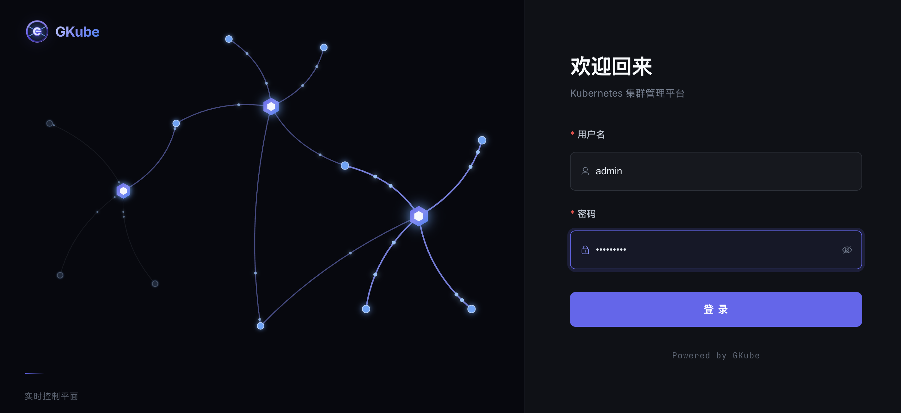<br><sub>1. 登陆页</sub></td>
    <td align="center">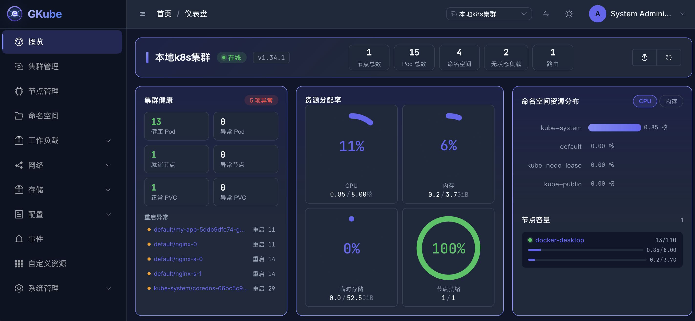<br><sub>2. 首页</sub></td>
    <td align="center">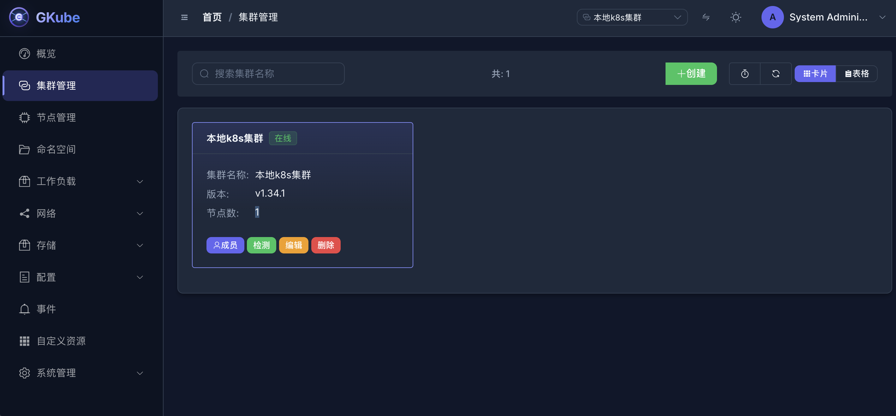<br><sub>3. 集群管理</sub></td>
  </tr>
  <tr>
    <td align="center">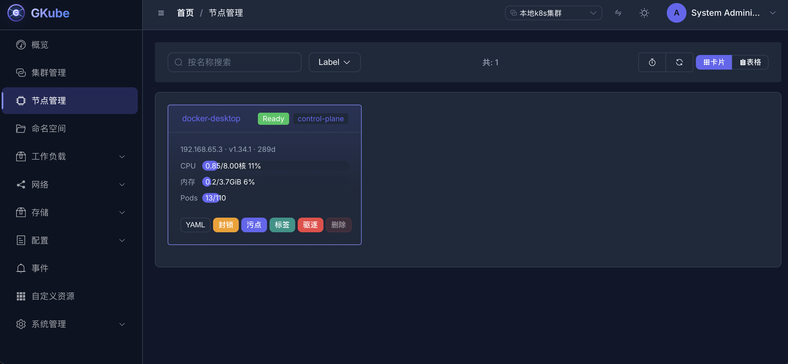<br><sub>4. 节点管理</sub></td>
    <td align="center">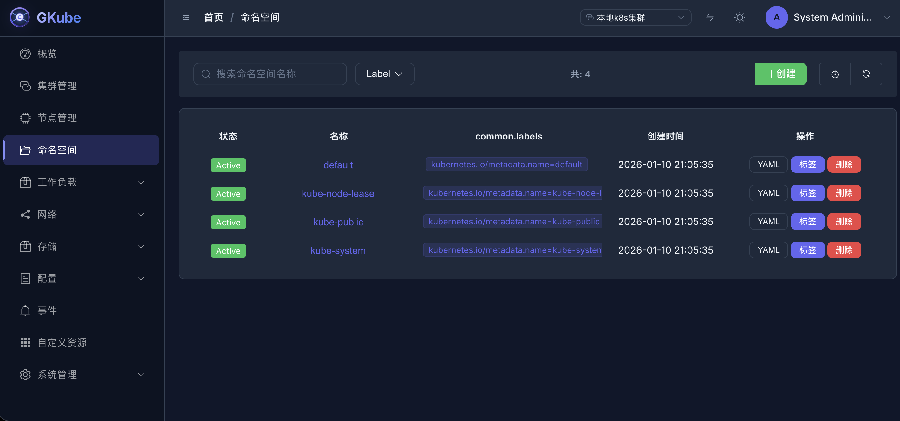<br><sub>5. 命名空间</sub></td>
    <td align="center">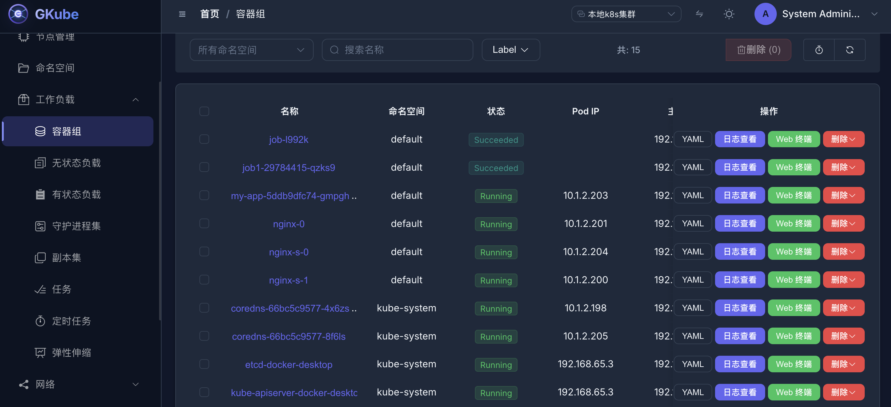<br><sub>6. 容器组列表</sub></td>
  </tr>
  <tr>
    <td align="center">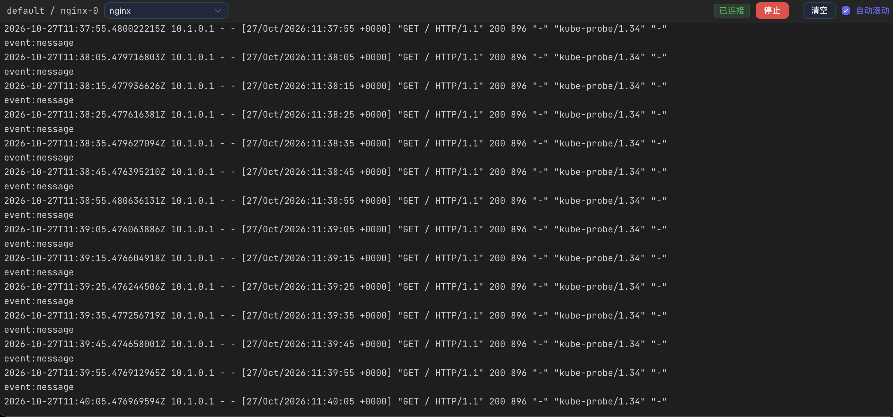<br><sub>6.1 容器日志查看</sub></td>
    <td align="center">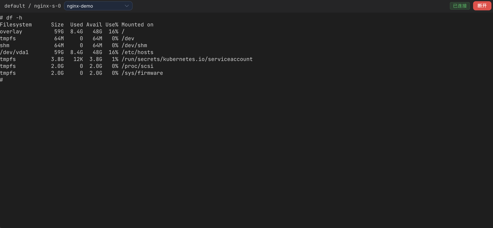<br><sub>6.2 终端</sub></td>
    <td align="center">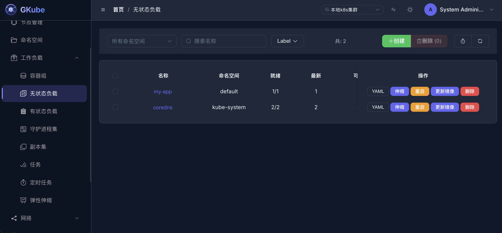<br><sub>7. 无状态负载</sub></td>
  </tr>
  <tr>
    <td align="center">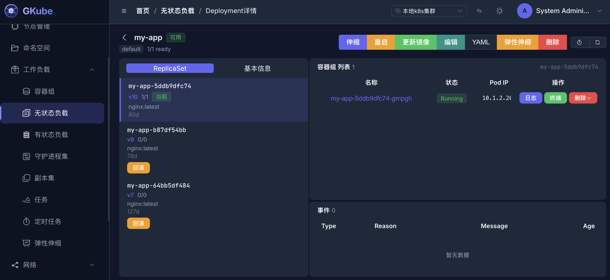<br><sub>7.1 无状态负载详情</sub></td>
    <td align="center">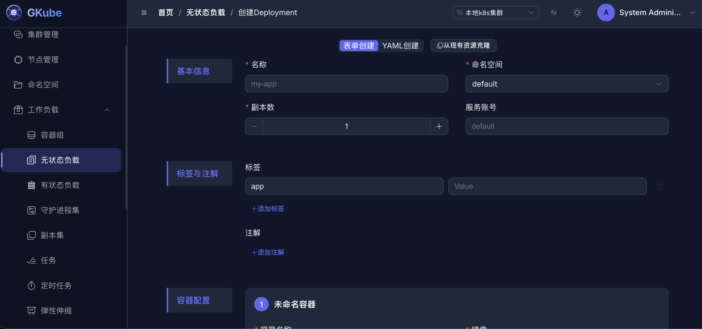<br><sub>7.2 无状态负载创建</sub></td>
    <td align="center">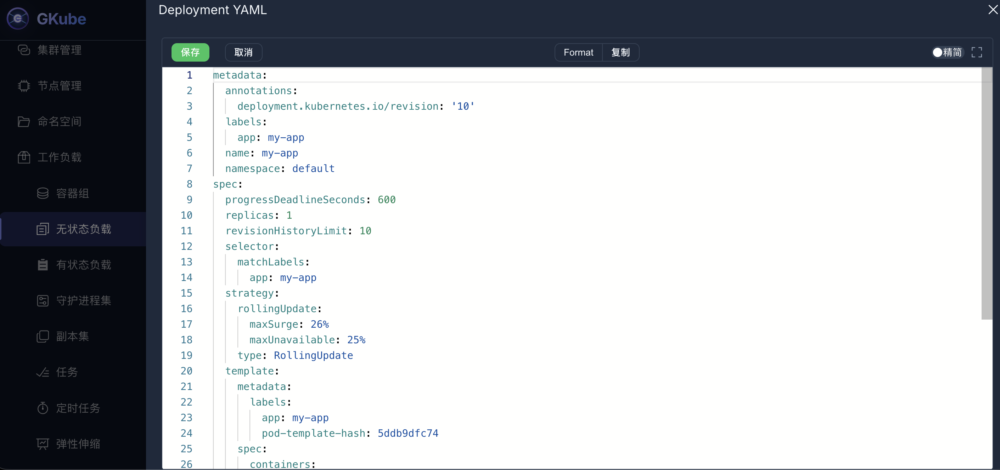<br><sub>7.3 无状态负载 YAML</sub></td>
  </tr>
  <tr>
    <td align="center">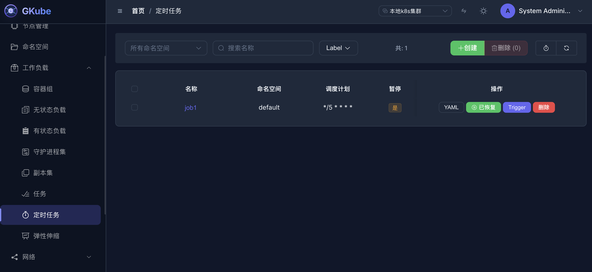<br><sub>8. 定时任务</sub></td>
    <td align="center">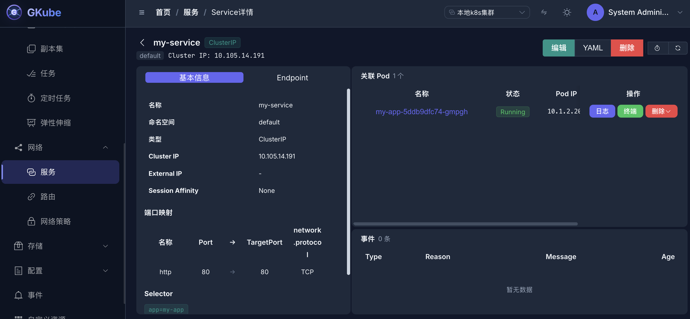<br><sub>9. 服务详情</sub></td>
    <td align="center">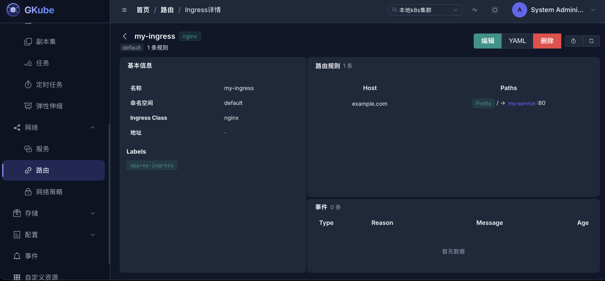<br><sub>10. 路由详情</sub></td>
  </tr>
  <tr>
    <td align="center">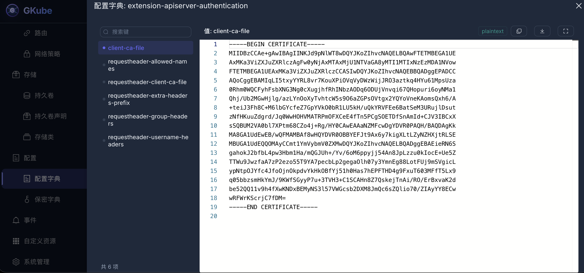<br><sub>11. 配置字典详情</sub></td>
    <td align="center">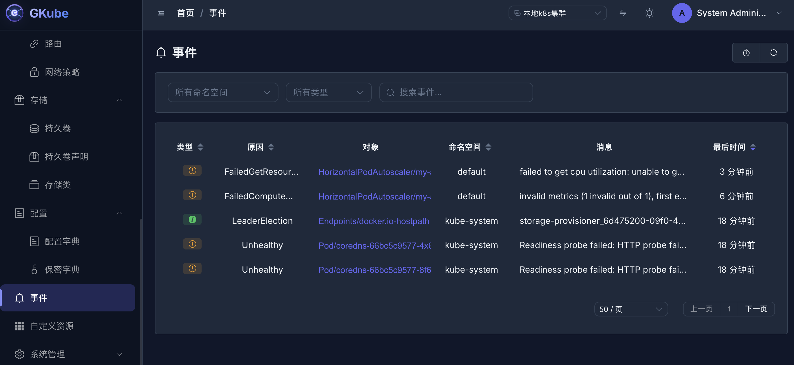<br><sub>12. 事件</sub></td>
    <td align="center">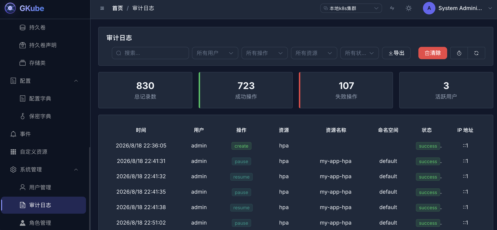<br><sub>13. 审计日志</sub></td>
  </tr>
  <tr>
    <td align="center">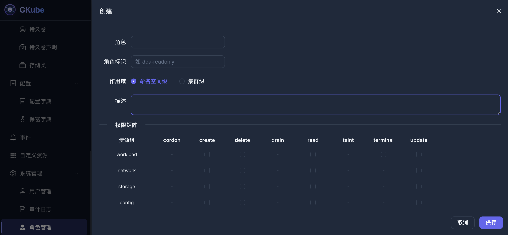<br><sub>14. 角色管理</sub></td>
    <td></td>
    <td></td>
  </tr>
</table>

## 核心特性

### 多集群统一纳管

- 接入多套 K8s 集群，通过界面一键切换
- 自动健康检查（每 30s），实时感知集群状态
- Kubeconfig 加密存储（AES-256-GCM）
- 集群连接自动校验，接入前验证可用性

### 全资源类型覆盖

支持 21 种 K8s 资源类型的完整生命周期管理：

| 资源分类 | 支持资源 |
|---------|---------|
| 工作负载 | Pod、Deployment、StatefulSet、DaemonSet、Job、CronJob、ReplicaSet、HPA |
| 网络 | Service、Ingress、NetworkPolicy |
| 存储 | PV、PVC、StorageClass、VolumeSnapshot、VolumeSnapshotClass |
| 配置 | ConfigMap、Secret、ResourceQuota、LimitRange |
| 集群 | Namespace、Node、Event、CRD |

**每种资源支持的操作**：列表、详情、YAML 编辑、创建、更新、删除，以及资源特定的运维操作（扩缩容、重启、回滚、镜像更新等）。

### 运维工具箱

#### Web 终端

- 基于 xterm.js 的浏览器内终端
- 支持选择应用容器和 Init 容器
- 动态窗口大小调整
- 会话录制（Asciinate 格式），支持审计回放

#### 实时日志查看

- SSE 实时日志流
- 支持容器选择
- 自动滚动，最大 5000 行缓冲
- 静态日志拉取（支持尾部行数配置）

#### 节点运维

- Cordon/Uncordon（标记不可调度）
- Drain（驱逐 Pod，支持多种选项）
- 标签和污点管理

### 安全与权限

#### 认证体系

- JWT 双 Token 认证（Access Token + Refresh Token）
- WebSocket 一次性 Ticket 认证（30s 有效期）
- 登录接口限流（IP 级令牌桶，5 次/分钟）
- 密码 bcrypt 加密

#### RBAC 权限模型

- 双作用域：集群级 / 命名空间级
- 11 种资源组：workload、network、storage、config、namespace、node、event、terminal、audit、crd、cluster_mgmt
- 细粒度动词：read、create、update、delete、cordon、taint、drain、terminal
- 权限诊断（CanI）：模拟检查用户权限
- 超级管理员绕过机制

#### 审计日志

- 自动记录所有 K8s 写操作
- Elasticsearch 存储，支持文件降级
- 丰富的审计字段：用户、操作、资源、IP、耗时等
- 多维度聚合统计
- 支持按用户、操作、资源、状态筛选

### 可视化仪表盘

- 集群概览：节点数、Pod 数、命名空间数、工作负载数
- 资源分配：CPU、内存、存储使用环形图
- 命名空间维度：资源使用柱状图（Top N）
- 节点容量：各节点 CPU/内存使用率
- 健康面板：异常 Pod、重启 Pod、PVC 问题汇总

## 技术架构

### 后端

| 组件 | 技术选型 |
|-----|---------|
| HTTP 框架 | Gin |
| ORM | GORM (MySQL) |
| K8s 客户端 | client-go |
| 配置管理 | Viper (YAML) |
| CLI | Cobra |
| 日志 | Logrus + Lumberjack |
| 审计存储 | Elasticsearch 7.x |
| WebSocket | gorilla/websocket |
| 对象存储 | MinIO (S3 兼容) |

### 前端

| 组件 | 技术选型 |
|-----|---------|
| 框架 | Vue 3 + TypeScript |
| UI 库 | Element Plus |
| 状态管理 | Pinia |
| 构建工具 | Vite |
| 终端 | xterm.js |
| YAML 编辑器 | Monaco Editor |
| 国际化 | Vue I18n |

### 工程化特性

#### 后端

- **模块化架构**：每个领域独立模块（api/service/model/params）
- **中间件链**：CORS、JWT、审计、权限、RBAC、限流、Origin 校验
- **优雅停机**：信号处理 + 5s 超时
- **后台任务**：集群健康检查协程（带并发控制）
- **错误处理**：自定义 AppError 类型，HTTP 状态码 + 业务错误码
- **分页**：支持 K8s Continue Token 游标分页和 MySQL 偏移分页

#### 前端

- **TypeScript 严格模式**：noUnusedLocals、noUnusedParameters
- **路由守卫**：Token 认证 + 管理员路由保护
- **请求拦截器**：Token 注入、集群名注入、401 自动刷新、403 处理
- **静默 Token 刷新**：队列机制，自动重试 pending 请求
- **通用资源 API 工厂**：可复用的 CRUD 函数
- **响应式布局**：CSS Grid + 断点适配

#### 部署

- **Docker 化**：多阶段构建
- **一键启动**：docker-compose（MySQL + ES + 应用）
- **数据库迁移**：GORM AutoMigrate + Seed 命令
- **日志轮转**：Lumberjack 自动切割

## 快速开始

### 前置要求

- Go 1.21+
- Node.js 18+
- MySQL 8.0+
- Elasticsearch 7.x（可选，用于审计日志）
- 有效的 Kubernetes 集群 kubeconfig

### 启动服务

```bash
# 启动基础设施
cd backend && docker-compose up -d

# 初始化数据库
go run main.go migrate
go run main.go seed

# 启动后端
go run main.go

# 启动前端（新终端）
cd frontend && npm install && npm run dev
```

访问 `http://localhost:5173`，使用默认账号登录。

### 环境变量

平台通过 `backend/config/config.yaml` 配置，支持：

- Server 端口、CORS 白名单
- MySQL 连接信息
- Elasticsearch 连接信息
- Redis 连接信息
- 审计日志配置
- WebSocket Origin 白名单

## API 概览

所有 API 挂载在 `/v1` 前缀下：

| 路径前缀 | 说明 |
|---------|-----|
| `/v1/auth` | 认证（登录、刷新、WebSocket Ticket） |
| `/v1/users` | 用户管理 |
| `/v1/roles` | 角色管理 |
| `/v1/clusters` | 集群管理 |
| `/v1/dashboard` | 仪表盘数据 |
| `/v1/k8s/*` | K8s 资源操作（29 个子路径） |
| `/v1/audit` | 审计日志查询 |

## License

MIT
